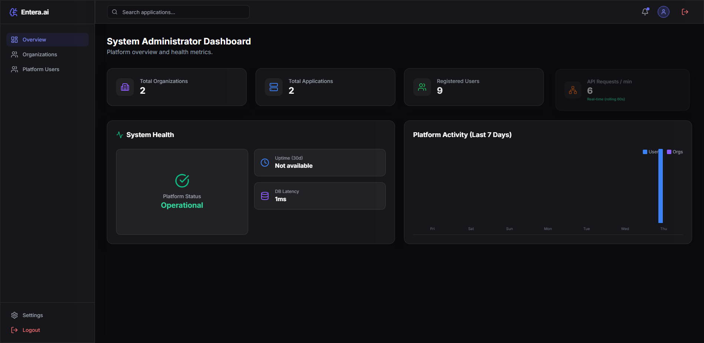

# Entera.ai — Test Execution Report: TC_001

## 1. Test Case Summary Table

| Field / Attribute | Value / Details |
| :--- | :--- |
| **Project Name** | Entera.ai |
| **Test Case ID** | `TC_001` |
| **Test Case Title** | Verify Login with Valid Administrator Credentials |
| **Module Name** | Authentication / Login |
| **Test Description** | Verify that an authorized administrator can log in to Entera.ai using valid credentials and successfully access the administrator dashboard. |
| **Preconditions** | 1. Entera.ai frontend application is running and accessible at `http://localhost:5173`.<br>2. Backend REST API service is active at `http://localhost:5000` with PostgreSQL connected.<br>3. Valid administrator test account exists in the database (`admin@gmail.com` / `sys_admin`).<br>4. Google Chrome browser and compatible Selenium WebDriver are installed. |
| **Test Designed Date** | 2026-10-22 |
| **Test Executed Date** | 2026-10-22 |
| **Test Steps** | 1. Launch Google Chrome browser using Selenium WebDriver in headless mode (`--headless=new`).<br>2. Navigate to `http://localhost:5173/login`.<br>3. Wait until the login form is rendered and visible.<br>4. Locate username/email input (`#login-username`) and password input (`#login-password`).<br>5. Enter valid administrator credentials (`admin@gmail.com` / `[PROTECTED - CONFIGURED_IN_ENV]`).<br>6. Click the `Login` submit button (`button[type="submit"]`).<br>7. Wait for authentication response and post-login URL redirect.<br>8. Verify the browser redirects to `/admin/dashboard`.<br>9. Verify that expected dashboard elements are displayed (`System Administrator Dashboard` heading, navigation sidebar, and platform metric cards).<br>10. Confirm zero login error alerts (`div[role="alert"]`) are visible.<br>11. Capture screenshot evidence saving to `screenshots/tc001_login_success.png`.<br>12. Safely close browser session. |
| **Test Data** | • **Application URL:** `http://localhost:5173`<br>• **Login URL:** `http://localhost:5173/login`<br>• **Username / Email:** `admin@gmail.com`<br>• **Password:** `[PROTECTED - CONFIGURED_IN_ENV]`<br>• **Expected Redirection URL:** `http://localhost:5173/admin/dashboard` |
| **Expected Result** | The administrator is authenticated successfully, redirected to `/admin/dashboard`, and presented with the System Administrator Dashboard UI (including platform overview metrics, sidebar navigation, and session controls) with no login error alerts. |
| **Actual Result** | The administrator authenticated successfully, redirected to `http://localhost:5173/admin/dashboard`, and the System Administrator Dashboard heading (`System Administrator Dashboard`), sidebar navigation, metric cards, and session controls rendered completely. Zero errors were displayed. |
| **Status** | **PASS** |
| **Browser and Version** | Google Chrome 155.0.8059.86 (Windows 64-bit) |
| **Automation Framework & Version** | Python 3.14.0, pytest 9.1.1, Selenium WebDriver 4.51.0 |
| **Defects or Remarks** | None. All explicit wait conditions and assertions passed within 7.77 seconds. |
| **Screenshot Evidence** | `screenshots/tc001_login_success.png` (84.5 KB) |

---

## 2. Test Execution Log Output

```text
============================= test session starts =============================
platform win32 -- Python 3.14.0, pytest-9.1.1, pluggy-1.7.0 -- C:\Users\sneha\AppData\Local\Programs\Python\Python314\python.exe
cachedir: .pytest_cache
rootdir: C:\Users\sneha\Downloads\Entera_Project
collecting ... collected 1 item

test_login.py::test_tc001_valid_admin_login 
======================================================================
STARTING TEST TC_001: Verify Login with Valid Administrator Credentials
Target URL: http://localhost:5173/login
Admin User: admin@gmail.com
Admin Password: [PROTECTED - 9 chars]
======================================================================
[Step 1] Navigating to login page...
[Step 2] Waiting for login form elements...
  [OK] Login form and interactive fields verified.
[Step 3] Entering administrator credentials...
  [OK] Credentials entered into form.
[Step 4] Submitting login form...
[Step 5] Awaiting authentication and post-login redirection...
  [OK] Redirect occurred. Current URL: http://localhost:5173/admin/dashboard
  [OK] Redirect URL matches expected administrator dashboard: /admin/dashboard
  [OK] Confirmed no error alerts are present on the page.
[Step 8] Verifying administrator dashboard UI components...
  [OK] Dashboard heading verified: 'System Administrator Dashboard'
  [OK] Authenticated dashboard sidebar navigation verified.
  [OK] Authenticated session controls (Logout button) confirmed present.
[Step 9] Capturing evidence screenshot: C:\Users\sneha\Downloads\Entera_Project\screenshots\tc001_login_success.png...
  [OK] Screenshot successfully saved (84549 bytes).
======================================================================
TEST TC_001 STATUS: PASS
Administrator successfully authenticated and accessed the dashboard.
======================================================================
PASSED

============================== 1 passed in 7.77s ==============================
```

---

## 3. Visual Screenshot Evidence

The following screenshot was captured by Selenium upon successful post-login redirection to the administrator dashboard:



---

## 4. Verification Checkpoints

| Checkpoint # | Description | Locator / Evaluation Method | Outcome |
| :---: | :--- | :--- | :---: |
| **CP-01** | Login Page Form Visibility | `By.ID("login-username")` & `By.ID("login-password")` displayed | **PASSED** |
| **CP-02** | Credential Input Handling | Form inputs accept user & password without layout breakage | **PASSED** |
| **CP-03** | Submit Button Interactivity | `By.CSS_SELECTOR("button[type='submit']")` clickable & triggers API call | **PASSED** |
| **CP-04** | Post-Login Redirection | Browser navigates away from `/login` to `/admin/dashboard` | **PASSED** |
| **CP-05** | Error Alert Absence | `By.CSS_SELECTOR("div[role='alert']")` not displayed | **PASSED** |
| **CP-06** | Dashboard Heading Rendering | `By.XPATH("//h1[contains(., 'System Administrator Dashboard')]")` visible | **PASSED** |
| **CP-07** | Sidebar Navigation Rendering | `By.XPATH("//span[contains(., 'Entera.ai')]")` brand link visible | **PASSED** |
| **CP-08** | Authenticated Session Controls | `By.XPATH("//button[@title='Logout' or contains(., 'Logout')]")` present | **PASSED** |
| **CP-09** | Evidence Capture | `tc001_login_success.png` saved to `screenshots/` directory | **PASSED** |
| **CP-10** | Safe Teardown | Chrome WebDriver session cleanly closed via fixture teardown | **PASSED** |
