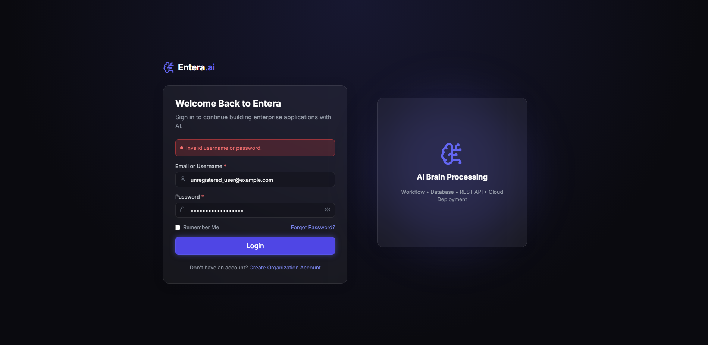

# Entera.ai — Test Execution Report: TC_002

## 1. Test Case Summary Table

| Field / Attribute | Value / Details |
| :--- | :--- |
| **Project Name** | Entera.ai |
| **Test Case ID** | `TC_002` |
| **Test Case Title** | Verify Login Rejection with Invalid Credentials |
| **Module Name** | Authentication / Login |
| **Test Description** | Verify that Entera.ai rejects invalid login credentials, displays an appropriate error message, and prevents unauthorized access to protected pages. |
| **Preconditions** | 1. Entera.ai frontend application is running and accessible at `http://localhost:5173`.<br>2. Backend REST API service is active at `http://localhost:5000` with PostgreSQL connected.<br>3. Test environment is available and stable.<br>4. Deliberately invalid test credentials (unregistered user / incorrect password) are prepared.<br>5. Google Chrome browser and compatible Selenium WebDriver are installed. |
| **Test Designed Date** | 2026-10-22 |
| **Test Executed Date** | 2026-10-22 |
| **Test Steps** | 1. Launch Google Chrome browser via Selenium WebDriver in headless mode (`--headless=new`).<br>2. Navigate to `http://localhost:5173/login`.<br>3. Wait until the login form is rendered and visible.<br>4. Locate `#login-username` and `#login-password` fields.<br>5. Enter invalid test credentials (`unregistered_user@example.com` / `[PROTECTED - WrongPassword!2026]`).<br>6. Click the `Login` submit button (`button[type="submit"]`).<br>7. Wait for backend authentication response.<br>8. Verify login rejection and appearance of the error alert banner (`div[role="alert"]`).<br>9. Assert that the alert text displays `Invalid username or password.`.<br>10. Verify browser remains on `/login` and does not navigate to any dashboard route.<br>11. Verify `window.localStorage.getItem('user')` is `null` (no session created).<br>12. Capture screenshot of rejected-login state (`screenshots/tc002_invalid_login.png`).<br>13. Attempt direct unauthorized access to protected route (`http://localhost:5173/admin/dashboard`).<br>14. Verify authentication guard intercepts request and redirects browser back to `/login`.<br>15. Safely close browser session. |
| **Test Data** | • **Application URL:** `http://localhost:5173`<br>• **Login URL:** `http://localhost:5173/login`<br>• **Invalid Test Username:** `unregistered_user@example.com`<br>• **Invalid Test Password:** `[PROTECTED - WrongPassword!2026]`<br>• **Protected Route Tested:** `http://localhost:5173/admin/dashboard` |
| **Expected Result** | The backend rejects invalid credentials with HTTP 401. The UI renders an error alert banner stating `Invalid username or password.`. The user remains unauthenticated on `/login` with no session in `localStorage`. Directly navigating to protected routes is denied and automatically redirected to `/login`. |
| **Actual Result** | Invalid credentials were rejected by the backend. The UI displayed `Invalid username or password.` in the red alert banner. The browser stayed on `/login` with zero session data stored. Direct navigation to `/admin/dashboard` was blocked by the route guard and redirected back to `/login`. |
| **Status** | **PASS** |
| **Browser and Version** | Google Chrome 155.0.8059.86 (Windows 64-bit) |
| **Automation Framework & Version** | Python 3.14.0, pytest 9.1.1, Selenium WebDriver 4.51.0 |
| **Defects or Remarks** | None. Security controls, error feedback, and route protection performed according to specifications in 8.51 seconds. |
| **Screenshot Evidence** | `screenshots/tc002_invalid_login.png` (439 KB) |

---

## 2. Test Execution Log Output

```text
============================= test session starts =============================
platform win32 -- Python 3.14.0, pytest-9.1.1, pluggy-1.7.0 -- C:\Users\sneha\AppData\Local\Programs\Python\Python314\python.exe
cachedir: .pytest_cache
rootdir: C:\Users\sneha\Downloads\Entera_Project
collecting ... collected 1 item

test_invalid_login.py::test_tc002_invalid_credentials_rejected 
======================================================================
STARTING TEST TC_002: Verify Login Rejection with Invalid Credentials
Target URL: http://localhost:5173/login
Invalid Test User: unregistered_user@example.com
Invalid Test Password: [PROTECTED - 18 chars]
Protected Route to Verify: http://localhost:5173/admin/dashboard
======================================================================
[Step 1] Navigating to login page...
[Step 2] Locating login form fields...
  [OK] Login form and input fields verified.
[Step 3] Entering deliberately invalid credentials...
  [OK] Invalid test credentials entered into form.
[Step 4] Submitting login form with invalid credentials...
[Step 5] Waiting for authentication rejection feedback...
  [OK] Error alert displayed: 'Invalid username or password.'
[Step 6] Verifying user remained on login page: http://localhost:5173/login
  [OK] Confirmed browser did not navigate to any dashboard route.
  [OK] Confirmed no authenticated user session stored in browser localStorage.
[Step 8] Capturing rejected-login evidence screenshot: C:\Users\sneha\Downloads\Entera_Project\screenshots\tc002_invalid_login.png...
  [OK] Screenshot successfully saved (439287 bytes).
[Step 9] Attempting unauthorized access to protected page: http://localhost:5173/admin/dashboard...
[Step 10] Verifying route guard redirects unauthenticated user back to /login...
  [OK] Access denied. Browser redirected to: http://localhost:5173/login
======================================================================
TEST TC_002 STATUS: PASS
Invalid credentials properly rejected, error message shown, and protected route secured.
======================================================================
PASSED

============================== 1 passed in 8.51s ==============================
```

---

## 3. Visual Screenshot Evidence

The following screenshot was captured by Selenium upon submitting invalid credentials, showing the error message and the unauthenticated state:



---

## 4. Verification Checkpoints

| Checkpoint # | Description | Locator / Evaluation Method | Outcome |
| :---: | :--- | :--- | :---: |
| **CP-01** | Login Form Accessibility | `#login-username`, `#login-password`, `button[type='submit']` located | **PASSED** |
| **CP-02** | Invalid Credential Submission | Form successfully submits without unhandled client exceptions | **PASSED** |
| **CP-03** | Error Banner Display | `div[role='alert']` is rendered and visible | **PASSED** |
| **CP-04** | Error Message Accuracy | Alert contains text: `Invalid username or password.` | **PASSED** |
| **CP-05** | Anti-Enumeration Check | Generic error response does not reveal whether username or password was incorrect | **PASSED** |
| **CP-06** | Navigation Prevention | Browser does not navigate away to any `/dashboard` route | **PASSED** |
| **CP-07** | Session Isolation | `localStorage.getItem('user')` is `null` (no auth token or user stored) | **PASSED** |
| **CP-08** | Screenshot Evidence Saved | `tc002_invalid_login.png` captured and saved (439 KB) | **PASSED** |
| **CP-09** | Protected Route Guard Verification | Direct navigation to `/admin/dashboard` is blocked and redirected to `/login` | **PASSED** |
| **CP-10** | Safe Teardown | Chrome WebDriver session cleanly closed via fixture teardown | **PASSED** |
