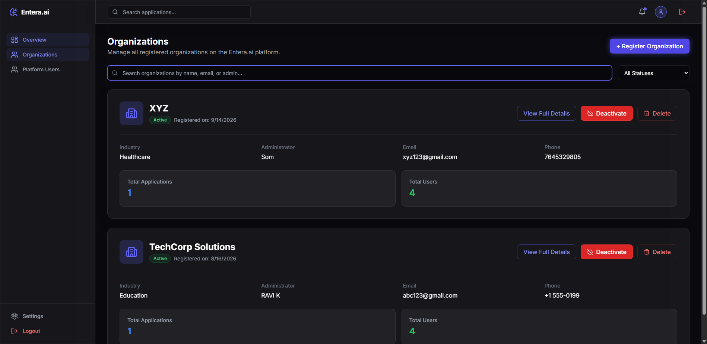

# Entera.ai — Test Execution Report: TC_003

## 1. Test Case Summary Table

| Field / Attribute | Value / Details |
| :--- | :--- |
| **Project Name** | Entera.ai |
| **Test Case ID** | `TC_003` |
| **Test Case Title** | Verify Organization Management |
| **Module Name** | Organizations |
| **Test Description** | Verify that an authorized Entera.ai administrator can access the Organizations module, view organization records, perform search filtering, and inspect detailed organization information. |
| **Preconditions** | 1. Entera.ai application is running and accessible at `http://localhost:5173`.<br>2. Backend REST API is active at `http://localhost:5000` with PostgreSQL connected.<br>3. Valid administrator test account exists (`admin@gmail.com` / `sys_admin`).<br>4. Administrator account possesses permission to access the Organizations module.<br>5. Registered test organizations exist in the database (e.g., `XYZ`, `TechCorp Solutions`).<br>6. Google Chrome browser and compatible Selenium WebDriver are available. |
| **Test Designed Date** | 2026-10-22 |
| **Test Executed Date** | 2026-10-22 |
| **Test Steps** | 1. Launch Google Chrome browser via Selenium WebDriver in headless mode (`--headless=new`).<br>2. Navigate to login page: `http://localhost:5173/login`.<br>3. Enter valid administrator test credentials and authenticate.<br>4. Wait for redirection to administrator dashboard (`/admin/dashboard`).<br>5. Locate and click the `Organizations` navigation link in the sidebar.<br>6. Verify browser navigates to `http://localhost:5173/admin/dashboard/orgs`.<br>7. Verify page heading (`Organizations`) and description.<br>8. Verify presence of Search input bar and Status filter dropdown.<br>9. Verify organization cards are loaded and displayed (`XYZ`, `TechCorp Solutions`).<br>10. Execute search with query `XYZ` and verify only matching card is rendered.<br>11. Execute search with non-matching query `NonExistentXYZ999` and verify empty search state (`No matching organizations`).<br>12. Clear search filter to restore full organization list.<br>13. Capture evidence screenshot of Organizations page (`screenshots/tc003_organizations.png`).<br>14. Click `View Full Details` on organization card (`XYZ`) and verify navigation to details page (`/admin/dashboard/orgs/9`).<br>15. Verify organization details view (title, status, industry, contact information).<br>16. Click `Back to Organizations` button and verify return to Organizations list.<br>17. Safely close browser session. |
| **Test Data** | • **Application URL:** `http://localhost:5173`<br>• **Login URL:** `http://localhost:5173/login`<br>• **Admin Username:** `admin@gmail.com`<br>• **Admin Password:** `[PROTECTED - CONFIGURED_IN_ENV]`<br>• **Organizations Route:** `http://localhost:5173/admin/dashboard/orgs`<br>• **Target Test Organization:** `XYZ` (ID: 9)<br>• **Search Test Query:** `XYZ`<br>• **Non-matching Search Query:** `NonExistentXYZ999` |
| **Expected Result** | Administrator successfully accesses Organizations module at `/admin/dashboard/orgs`. Page renders header, action buttons, search bar, and organization cards. Search filter dynamically filters cards and displays appropriate empty-state message when no matches are found. Clicking `View Full Details` loads the organization's details page with complete metadata and provides a working back-navigation control. |
| **Actual Result** | Organizations module loaded with heading `Organizations`. Discovered 2 active organizations (`XYZ` and `TechCorp Solutions`). Search filter confirmed dynamic filtering for `XYZ` and showed `No matching organizations` for non-matching input. `View Full Details` loaded organization #9 details successfully and returned back to the Organizations list upon clicking `Back to Organizations`. |
| **Status** | **PASS** |
| **Browser and Version** | Google Chrome 155.0.8059.86 (Windows 64-bit) |
| **Automation Framework & Version** | Python 3.14.0, pytest 9.1.1, Selenium WebDriver 4.51.0 |
| **Defects or Remarks** | None. Organization listing, search filtering, empty search handling, detail view navigation, and breadcrumb/return navigation all functioned correctly in 11.27 seconds. |
| **Screenshot Evidence** | `screenshots/tc003_organizations.png` (117 KB) |

---

## 2. Test Execution Log Output

```text
============================= test session starts =============================
platform win32 -- Python 3.14.0, pytest-9.1.1, pluggy-1.7.0 -- C:\Users\sneha\AppData\Local\Programs\Python\Python314\python.exe
cachedir: .pytest_cache
rootdir: C:\Users\sneha\Downloads\Entera_Project
collecting ... collected 1 item

test_organizations.py::test_tc003_organization_management 
======================================================================
STARTING TEST TC_003: Verify Organization Management
Target URL: http://localhost:5173
Admin User: admin@gmail.com
Organizations Route: http://localhost:5173/admin/dashboard/orgs
======================================================================
[Step 1] Navigating to login page...
[Step 2] Authenticating as administrator...
  [OK] Successfully authenticated and arrived at admin dashboard.
[Step 3] Locating 'Organizations' link in sidebar navigation...
[Step 4] Verifying navigation to Organizations management route...
  [OK] Navigation verified. Current URL: http://localhost:5173/admin/dashboard/orgs
[Step 5] Verifying page heading and description...
  [OK] Page heading verified: 'Organizations'
[Step 6] Verifying search and filter controls...
  [OK] Search bar and Status filter controls verified.
[Step 7] Checking organization records...
  [OK] Found 2 registered organization(s): ['XYZ', 'TechCorp Solutions']
  [OK] Selected test organization for operations: 'XYZ'
[Step 8] Testing search functionality with query 'XYZ'...
  [OK] Search filter confirmed matching organization: ['XYZ']
[Step 8b] Testing search with non-matching term 'NonExistentXYZ999'...
  [OK] Empty search feedback verified ('No matching organizations').
[Step 9] Capturing evidence screenshot: C:\Users\sneha\Downloads\Entera_Project\screenshots\tc003_organizations.png...
  [OK] Screenshot successfully saved (117701 bytes).
[Step 10] Testing 'View Full Details' for organization 'XYZ'...
  [OK] Successfully navigated to Organization Details. URL: http://localhost:5173/admin/dashboard/orgs/9
  [OK] Organization title displayed on details page: 'XYZ'
  [OK] Return to Organizations list page verified.
======================================================================
TEST TC_003 STATUS: PASS
Organizations module, list view, search filtering, and details view verified.
======================================================================
PASSED

============================= 1 passed in 11.27s ==============================
```

---

## 3. Visual Screenshot Evidence

The following screenshot captures the Organizations module with the active sidebar link, search input, status filter, and registered organization cards:



---

## 4. Verification Checkpoints

| Checkpoint # | Description | Locator / Evaluation Method | Outcome |
| :---: | :--- | :--- | :---: |
| **CP-01** | Admin Authentication | Post-login redirect to `/admin/dashboard` verified | **PASSED** |
| **CP-02** | Sidebar Navigation Link | `//aside//a[contains(@href, '/admin/dashboard/orgs')]` displayed and clickable | **PASSED** |
| **CP-03** | Organizations Page Route | Browser successfully reaches `http://localhost:5173/admin/dashboard/orgs` | **PASSED** |
| **CP-04** | Page Heading & Header | `//h1[contains(text(), 'Organizations')]` verified | **PASSED** |
| **CP-05** | Search Input Rendering | `//input[contains(@placeholder, 'Search organizations')]` displayed | **PASSED** |
| **CP-06** | Status Dropdown Rendering | `//select[contains(@class, 'h-10')]` displayed with options | **PASSED** |
| **CP-07** | Organization Data Retrieval | Discovered active test organizations (`XYZ`, `TechCorp Solutions`) | **PASSED** |
| **CP-08** | Dynamic Search Match | Typing `XYZ` filters cards to display only matching organization | **PASSED** |
| **CP-09** | Empty Search Feedback | Non-matching query triggers `No matching organizations` card | **PASSED** |
| **CP-10** | Evidence Capture | `tc003_organizations.png` captured and saved (117 KB) | **PASSED** |
| **CP-11** | Organization Details Navigation | `View Full Details` button opens `/admin/dashboard/orgs/9` | **PASSED** |
| **CP-12** | Return / Breadcrumb Navigation | `Back to Organizations` button navigates cleanly back to list | **PASSED** |
| **CP-13** | Safe Teardown | Chrome WebDriver session cleanly closed via fixture teardown | **PASSED** |
