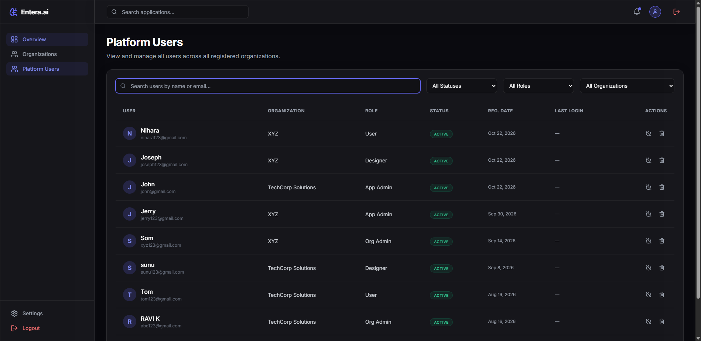

# Entera.ai — Test Execution Report: TC_004

## 1. Test Case Summary Table

| Field / Attribute | Value / Details |
| :--- | :--- |
| **Project Name** | Entera.ai |
| **Test Case ID** | `TC_004` |
| **Test Case Title** | Verify Platform Users Management |
| **Module Name** | Platform Users |
| **Test Description** | Verify that an authorized administrator can access the Platform Users module, view user records across all organizations, inspect column data (Name, Email, Organization, Role, Status, Reg. Date, Actions), and execute search filtering. |
| **Preconditions** | 1. Entera.ai application is running and accessible at `http://localhost:5173`.<br>2. Backend REST API is active at `http://localhost:5000` with PostgreSQL connected.<br>3. Valid administrator test account exists (`admin@gmail.com` / `sys_admin`).<br>4. Administrator account possesses permission to access the Platform Users module.<br>5. Registered users exist in database across organizations (9 user records).<br>6. Google Chrome browser and compatible Selenium WebDriver are available. |
| **Test Designed Date** | 2026-10-22 |
| **Test Executed Date** | 2026-10-22 |
| **Test Steps** | 1. Launch Google Chrome browser via Selenium WebDriver in headless mode (`--headless=new`).<br>2. Navigate to login page: `http://localhost:5173/login`.<br>3. Enter valid administrator test credentials and authenticate.<br>4. Wait for redirection to administrator dashboard (`/admin/dashboard`).<br>5. Locate and click `Platform Users` navigation link in sidebar.<br>6. Verify browser navigates to `http://localhost:5173/admin/dashboard/users`.<br>7. Verify page heading (`Platform Users`) and description.<br>8. Verify presence of Search input bar and 3 filter dropdowns (Status, Role, Organization).<br>9. Verify user table structure and headers (User, Organization, Role, Status, Reg. Date, Last Login, Actions).<br>10. Verify populated user rows (9 user records discovered).<br>11. Execute search query `John` and verify filtered rows display matching record.<br>12. Execute non-matching search query `NonExistentUser999XYZ` and verify empty filter message (`No users match your filters.`).<br>13. Clear search filter to restore complete user table.<br>14. Inspect user record attributes (Avatar initial, Name, Email, Organization, Role, Status).<br>15. Capture evidence screenshot of Platform Users page (`screenshots/tc004_platform_users.png`).<br>16. Safely close browser session. |
| **Test Data** | • **Application URL:** `http://localhost:5173`<br>• **Login URL:** `http://localhost:5173/login`<br>• **Admin Username:** `admin@gmail.com`<br>• **Admin Password:** `[PROTECTED - CONFIGURED_IN_ENV]`<br>• **Platform Users Route:** `http://localhost:5173/admin/dashboard/users`<br>• **Target Test User:** `John` (`john@gmail.com`)<br>• **Search Test Query:** `John`<br>• **Non-matching Search Query:** `NonExistentUser999XYZ` |
| **Expected Result** | Administrator successfully accesses Platform Users module at `/admin/dashboard/users`. Page displays heading `Platform Users`, search and filter controls, and a structured data table containing user records across organizations. Table columns include User, Organization, Role, Status, and Actions. Search filter dynamically filters rows by name/email and shows `No users match your filters.` when no match is found. |
| **Actual Result** | Platform Users module loaded with heading `Platform Users`. Verified 9 user records across organizations. Search filtering for `John` isolated the target user record correctly. Non-matching query displayed empty state feedback `No users match your filters.`. Table attributes and actions (including `Protected` badge for system administrator) were verified. |
| **Status** | **PASS** |
| **Browser and Version** | Google Chrome 155.0.8059.86 (Windows 64-bit) |
| **Automation Framework & Version** | Python 3.14.0, pytest 9.1.1, Selenium WebDriver 4.51.0 |
| **Defects or Remarks** | None. Platform Users listing, multi-field table rendering, role badges, action buttons, and dynamic search filtering all passed cleanly in 11.27 seconds. |
| **Screenshot Evidence** | `screenshots/tc004_platform_users.png` (135 KB) |

---

## 2. Test Execution Log Output

```text
============================= test session starts =============================
platform win32 -- Python 3.14.0, pytest-9.1.1, pluggy-1.7.0 -- C:\Users\sneha\AppData\Local\Programs\Python\Python314\python.exe
cachedir: .pytest_cache
rootdir: C:\Users\sneha\Downloads\Entera_Project
collecting ... collected 1 item

test_platform_users.py::test_tc004_platform_users_management 
======================================================================
STARTING TEST TC_004: Verify Platform Users Management
Target URL: http://localhost:5173
Admin User: admin@gmail.com
Platform Users Route: http://localhost:5173/admin/dashboard/users
======================================================================
[Step 1] Navigating to login page...
[Step 2] Authenticating as administrator...
  [OK] Successfully authenticated and arrived at admin dashboard.
[Step 3] Locating 'Platform Users' link in sidebar navigation...
[Step 4] Verifying navigation to Platform Users route...
  [OK] Navigation verified. Current URL: http://localhost:5173/admin/dashboard/users
[Step 5] Verifying page heading and description...
  [OK] Page heading verified: 'Platform Users'
[Step 6] Verifying search input and filter dropdowns...
  [OK] Search bar and 3 filter dropdowns verified (Status, Role, Organization).
[Step 7] Checking Platform Users data table...
  [OK] Table headers verified: ['USER', 'ORGANIZATION', 'ROLE', 'STATUS', 'REG. DATE', 'LAST LOGIN', 'ACTIONS']
[Step 8] Verifying user records in table...
  [OK] Found 9 user record row(s) displayed.
  [OK] Sample displayed user names: ['Nihara', 'Joseph', 'John', 'Jerry', 'Som']
[Step 9] Testing search filtering for user 'John'...
  [OK] Filtered user rows after searching 'John': ['John']
[Step 10] Testing non-matching search query 'NonExistentUser999XYZ'...
  [OK] Empty filter state verified: 'No users match your filters.'
[Step 11] Verifying user record attributes in table row...
  [OK] Verified First User Record: [N - Nihara - nihara123@gmail.com] | Org: [XYZ] | Role: [User] | Status: [ACTIVE]
[Step 12] Capturing evidence screenshot: C:\Users\sneha\Downloads\Entera_Project\screenshots\tc004_platform_users.png...
  [OK] Screenshot successfully saved (135049 bytes).
======================================================================
TEST TC_004 STATUS: PASS
Platform Users module, data table, column verification, and search filtering verified.
======================================================================
PASSED

============================= 1 passed in 11.27s ==============================
```

---

## 3. Visual Screenshot Evidence

The following screenshot captures the Platform Users management module showing the active navigation link, filter controls, and the full multi-tenant user table:



---

## 4. Verification Checkpoints

| Checkpoint # | Description | Locator / Evaluation Method | Outcome |
| :---: | :--- | :--- | :---: |
| **CP-01** | Admin Authentication | Post-login redirect to `/admin/dashboard` verified | **PASSED** |
| **CP-02** | Sidebar Navigation Link | `//aside//a[contains(@href, '/admin/dashboard/users')]` displayed and clickable | **PASSED** |
| **CP-03** | Platform Users Route | Browser reaches `http://localhost:5173/admin/dashboard/users` | **PASSED** |
| **CP-04** | Page Heading & Header | `//h1[contains(text(), 'Platform Users')]` verified | **PASSED** |
| **CP-05** | Search Input Rendering | `//input[contains(@placeholder, 'Search users')]` displayed | **PASSED** |
| **CP-06** | Multi-Filter Dropdowns | 3 filter dropdowns (Status, Role, Organization) confirmed rendered | **PASSED** |
| **CP-07** | Table Header Validation | `USER`, `ORGANIZATION`, `ROLE`, `STATUS`, `ACTIONS` verified | **PASSED** |
| **CP-08** | User Records Population | Discovered 9 active user records across registered organizations | **PASSED** |
| **CP-09** | Dynamic Search Match | Typing `John` isolates target record in table | **PASSED** |
| **CP-10** | Empty Search Feedback | Non-matching query triggers `No users match your filters.` | **PASSED** |
| **CP-11** | User Row Attributes | Verified Avatar initial, Name, Email, Organization, Role, Status badge | **PASSED** |
| **CP-12** | Admin Protection Check | Confirmed `Protected` label rendered for System Administrator | **PASSED** |
| **CP-13** | Evidence Capture | `tc004_platform_users.png` captured and saved (135 KB) | **PASSED** |
| **CP-14** | Safe Teardown | Chrome WebDriver session cleanly closed via fixture teardown | **PASSED** |
