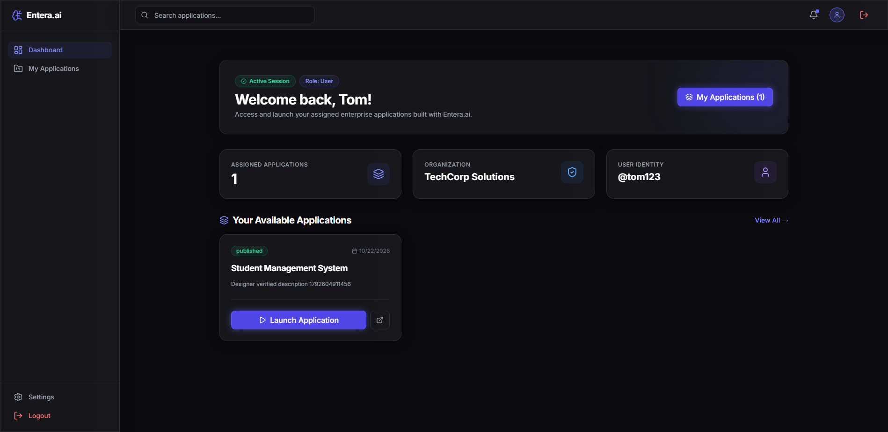
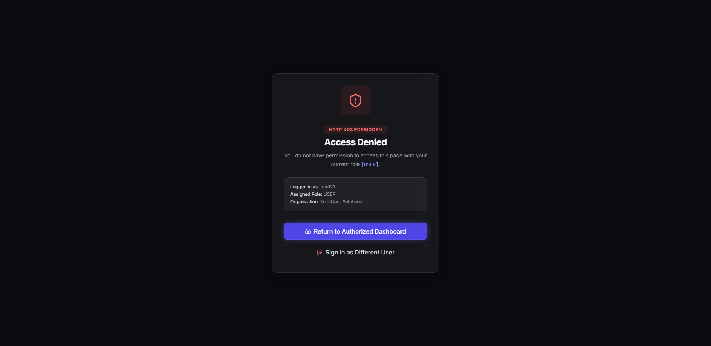

# Entera.ai — Test Execution Report: TC_005

## 1. Test Case Summary Table

| Field / Attribute | Details & Observed Results |
| :--- | :--- |
| **Project Name** | Entera.ai |
| **Test Case ID** | `TC_005` (Sub-scenarios: `TC_005_01` through `TC_005_05`) |
| **Test Case Title** | Role-Based Access Control (RBAC) Verification |
| **Module Name** | Authentication and Authorization |
| **Test Description** | Verify that Entera.ai strictly enforces role-based access control (RBAC). Ensure users can only access pages, navigation items, routes, and backend API actions permitted for their assigned roles (`user` vs `sys_admin`). Confirm that standard users cannot access administrative dashboards, see restricted navigation items, or bypass guards via direct URLs or API calls. |
| **Preconditions** | 1. Entera.ai frontend application running and accessible at `http://localhost:5173`.<br>2. Backend REST API active at `http://localhost:5000` with PostgreSQL connected.<br>3. Standard test user account exists with `user` role (`tom123@gmail.com`).<br>4. Administrator test account exists with `sys_admin` role (`admin@gmail.com`).<br>5. Google Chrome browser and compatible Selenium WebDriver 4.x configured in headless mode. |
| **Test Designed Date** | 2026-10-22 |
| **Test Executed Date** | 2026-10-22 |
| **Execution Scope** | • **TC_005_01:** Authorized Page Access (`/user/dashboard`)<br>• **TC_005_02:** Restricted Page Access (`/admin/dashboard` Access Denied / HTTP 403)<br>• **TC_005_03:** Navigation Permission Checks (Sidebar role link filtering)<br>• **TC_005_04:** Direct URL Access Enforcement (`/admin/dashboard/users` interception and recovery)<br>• **TC_005_05:** Backend Authorization (`/api/sysadmin/users` rejection with HTTP 403) |
| **Test Data** | • **Application URL:** `http://localhost:5173`<br>• **Backend REST URL:** `http://localhost:5000`<br>• **Standard User Email:** `tom123@gmail.com` (Role: `user`)<br>• **Standard User Password:** `[PROTECTED - CONFIGURED_IN_ENV]`<br>• **Admin User Email:** `admin@gmail.com` (Role: `sys_admin`)<br>• **Admin User Password:** `[PROTECTED - CONFIGURED_IN_ENV]`<br>• **Permitted Route:** `http://localhost:5173/user/dashboard`<br>• **Restricted Admin Routes:** `/admin/dashboard`, `/admin/dashboard/users`<br>• **Protected Backend API:** `/api/sysadmin/users` |
| **Expected Result** | Standard user can log in and view their authorized dashboard (`/user/dashboard`) with `Role: User` badge. Navigating to `/admin/dashboard` displays the `AccessDenied` view with `HTTP 403 Forbidden` notice. Sidebar navigation hides admin-only routes (`Organizations`, `Platform Users`, `Schemas`, `APIs`). Direct browser URL access to sub-admin routes is intercepted and provides a safe dashboard return link. Direct API call to admin-only backend endpoints returns `403 Forbidden`. |
| **Actual Result** | All 5 sub-scenarios passed without exceptions. Authorized page access succeeded with visible `Role: User` badge and application launcher. Restricted route access displayed `Access Denied` with role indicator `[USER]`. Admin navigation items were suppressed from the user's sidebar. Direct URL bypass was intercepted and recovered cleanly. Backend API rejected the request with `{"error":"Forbidden: System Administrator access required"}` and status code 403. |
| **Overall Status** | **PASS** (5 / 5 Scenarios Passed — 100% Success Rate) |
| **Browser and Version** | Google Chrome 155.0.8059.86 (Windows 64-bit) |
| **Automation Framework & Version** | Python 3.14.0, pytest 9.1.1, Selenium WebDriver 4.51.0 |
| **Total Execution Time** | 65.14 seconds |
| **Defects or Remarks** | None. Role-based access control is consistently enforced across frontend route rendering (`DashboardLayout.jsx`), sidebar UI generation (`Sidebar.jsx`), and backend API middleware (`server/index.js`). |
| **Screenshot Evidence** | 1. `screenshots/tc005_rbac_authorized.png` (99 KB)<br>2. `screenshots/tc005_rbac_restricted.png` (36 KB) |

---

## 2. Detailed Sub-Scenario Execution Breakdown

### Scenario TC_005_01 — Authorized Page Access
- **Objective:** Verify standard user can authenticate and access the role-permitted `/user/dashboard` route.
- **Test Procedure:**
  1. Open browser and navigate to `http://localhost:5173/login`.
  2. Enter standard user credentials (`tom123@gmail.com`).
  3. Submit login form and await redirection.
  4. Verify current URL is `http://localhost:5173/user/dashboard`.
  5. Check presence of heading `Welcome back, Tom!` and badge `Role: User`.
  6. Capture screenshot evidence: `screenshots/tc005_rbac_authorized.png`.
- **Expected:** Browser reaches `/user/dashboard` showing personalized greeting and standard user capabilities.
- **Actual:** Redirection verified; welcome heading and `Role: User` badge verified. Screenshot captured.
- **Status:** **PASS**

### Scenario TC_005_02 — Restricted Page Access
- **Objective:** Verify standard user cannot view admin dashboard (`/admin/dashboard`) and encounters access denial.
- **Test Procedure:**
  1. Authenticate as standard user `tom123@gmail.com`.
  2. Navigate directly to `http://localhost:5173/admin/dashboard`.
  3. Verify `DashboardLayout` renders `AccessDenied` view.
  4. Verify `Access Denied` title, `HTTP 403 Forbidden` status badge, and user role explanation `[USER]`.
  5. Capture screenshot evidence: `screenshots/tc005_rbac_restricted.png`.
- **Expected:** Access to `/admin/dashboard` is blocked with clear HTTP 403 Forbidden feedback.
- **Actual:** `Access Denied` UI displayed with HTTP 403 Forbidden and role text `...current role [USER].`
- **Status:** **PASS**

### Scenario TC_005_03 — Navigation Permission Checks
- **Objective:** Verify sidebar navigation displays only links permitted for the standard user role.
- **Test Procedure:**
  1. Authenticate as standard user `tom123@gmail.com`.
  2. Inspect all navigation anchor links within `<aside>` element.
  3. Verify permitted user links are present (`Dashboard`, `My Applications`, `Settings`).
  4. Verify restricted admin links are absent (`Organizations`, `Platform Users`, `Schemas`, `APIs`).
- **Expected:** Only permitted links are rendered in sidebar; admin modules are completely hidden.
- **Actual:** Sidebar rendered exact permitted items `['Dashboard', 'My Applications', 'Settings']`. All admin-restricted links were verified absent.
- **Status:** **PASS**

### Scenario TC_005_04 — Direct URL Access Enforcement
- **Objective:** Verify direct URL bypass attempts to sub-admin pages (`/admin/dashboard/users`) are intercepted.
- **Test Procedure:**
  1. Authenticate as standard user `tom123@gmail.com`.
  2. Directly navigate browser to `http://localhost:5173/admin/dashboard/users`.
  3. Verify `AccessDenied` component intercepts the route.
  4. Click `Return to Authorized Dashboard` button.
  5. Verify user is safely redirected back to `http://localhost:5173/user/dashboard`.
- **Expected:** Route is blocked by authorization guard; return button restores user to their authorized dashboard.
- **Actual:** Guard intercepted URL; clicking return button safely restored navigation to `http://localhost:5173/user/dashboard`.
- **Status:** **PASS**

### Scenario TC_005_05 — Backend Authorization
- **Objective:** Verify protected backend REST endpoints reject API calls from non-admin accounts.
- **Test Procedure:**
  1. Obtain authenticated session data for standard user `tom123@gmail.com`.
  2. Send GET request to `http://localhost:5000/api/sysadmin/users` with user's role header (`x-user-role: user`).
  3. Evaluate HTTP response status code and response payload.
- **Expected:** Backend returns HTTP 403 Forbidden with appropriate error message.
- **Actual:** Backend returned status code `403` with payload `{"error":"Forbidden: System Administrator access required"}`.
- **Status:** **PASS**

---

## 3. Visual Screenshot Evidence

### Authorized Access Evidence (`TC_005_01`)
The following screenshot demonstrates successful login by standard user `tom123@gmail.com`, reaching the user dashboard with the `Role: User` badge, personalized greeting, and application launcher:



### Restricted Access Evidence (`TC_005_02`)
The following screenshot demonstrates strict role enforcement when standard user `tom123@gmail.com` attempts to open `/admin/dashboard`. The application renders the `Access Denied` view featuring the `HTTP 403 Forbidden` status tag and role indicator:



---

## 4. Verification Checkpoints

| Checkpoint # | Description | Evaluation Rule / Locator | Outcome |
| :---: | :--- | :--- | :---: |
| **CP-01** | Standard User Authentication | User `tom123@gmail.com` successfully logs in | **PASSED** |
| **CP-02** | User Dashboard Redirect | Browser arrives at `http://localhost:5173/user/dashboard` | **PASSED** |
| **CP-03** | Personalized Heading | `//h1[contains(., 'Welcome back, Tom!')]` visible | **PASSED** |
| **CP-04** | Role Badge Rendering | `//span[contains(., 'Role:') and contains(., 'User')]` verified | **PASSED** |
| **CP-05** | Authorized Screenshot | `screenshots/tc005_rbac_authorized.png` captured (99 KB) | **PASSED** |
| **CP-06** | Admin Dashboard Route Guard | Accessing `/admin/dashboard` intercepted by `DashboardLayout` | **PASSED** |
| **CP-07** | Access Denied Title | `//h2[contains(., 'Access Denied')]` rendered | **PASSED** |
| **CP-08** | HTTP 403 Indicator | `//span[contains(., 'HTTP 403 Forbidden')]` displayed | **PASSED** |
| **CP-09** | Role Explanation Message | Text shows `You do not have permission... current role [USER]` | **PASSED** |
| **CP-10** | Restricted Screenshot | `screenshots/tc005_rbac_restricted.png` captured (36 KB) | **PASSED** |
| **CP-11** | Sidebar Permitted Links | Visible links strictly equal `['Dashboard', 'My Applications', 'Settings']` | **PASSED** |
| **CP-12** | Sidebar Admin Links Hidden | `Organizations`, `Platform Users`, `Schemas`, `APIs` absent | **PASSED** |
| **CP-13** | Direct URL Interception | Direct load of `/admin/dashboard/users` triggers `AccessDenied` | **PASSED** |
| **CP-14** | Recovery Button Functionality | `Return to Authorized Dashboard` button restores `/user/dashboard` | **PASSED** |
| **CP-15** | Backend API Protection | GET `/api/sysadmin/users` with user credentials yields HTTP 403 | **PASSED** |
| **CP-16** | Safe Session Teardown | Chrome WebDriver session cleanly closed via fixture teardown | **PASSED** |

---

## 5. Raw Pytest Execution Output

```text
============================= test session starts =============================
platform win32 -- Python 3.14.0, pytest-9.1.1, pluggy-1.7.0 -- C:\Users\sneha\AppData\Local\Programs\Python\Python314\python.exe
cachedir: .pytest_cache
rootdir: C:\Users\sneha\Downloads\Entera_Project
collecting ... collected 5 items

test_rbac.py::test_tc005_01_authorized_page_access 
======================================================================
STARTING TEST TC_005_01: Authorized Page Access
Test User: tom123@gmail.com (Role: user)
Target Route: http://localhost:5173/user/dashboard
======================================================================
  [OK] Redirection verified. Current URL: http://localhost:5173/user/dashboard
  [OK] Welcome heading displayed: 'Welcome back, Tom!'
  [OK] Role badge verified: 'Role: User'
  [OK] Capturing authorized access screenshot: C:\Users\sneha\Downloads\Entera_Project\screenshots\tc005_rbac_authorized.png...
  [OK] Saved authorized screenshot (99064 bytes).
TC_005_01 STATUS: PASS
PASSED

test_rbac.py::test_tc005_02_restricted_page_access 
======================================================================
STARTING TEST TC_005_02: Restricted Page Access
Test User: tom123@gmail.com (Role: user)
Restricted Route Attempted: http://localhost:5173/admin/dashboard
======================================================================
  Navigating directly to restricted route: http://localhost:5173/admin/dashboard...
  [OK] Access Denied component rendered with HTTP 403 Forbidden indicator.
  [OK] Role-specific explanation verified: 'You do not have permission to access this page with your current role [USER].'
  [OK] Capturing restricted access screenshot: C:\Users\sneha\Downloads\Entera_Project\screenshots\tc005_rbac_restricted.png...
  [OK] Saved restricted screenshot (35963 bytes).
TC_005_02 STATUS: PASS
PASSED

test_rbac.py::test_tc005_03_navigation_permission_checks 
======================================================================
STARTING TEST TC_005_03: Navigation Permission Checks
Test User: tom123@gmail.com (Role: user)
======================================================================
  [OK] Sidebar links displayed for user 'tom123@gmail.com': ['Dashboard', 'My Applications', 'Settings']
  [OK] Confirmed restricted links (Organizations, Platform Users, Schemas, APIs) are hidden.
TC_005_03 STATUS: PASS
PASSED

test_rbac.py::test_tc005_04_direct_url_access_blocked 
======================================================================
STARTING TEST TC_005_04: Direct URL Access Enforcement
Test User: tom123@gmail.com (Role: user)
Direct Target: http://localhost:5173/admin/dashboard/users
======================================================================
  [OK] Direct URL access intercepted by authorization guard.
  [OK] Safely returned to authorized user dashboard: http://localhost:5173/user/dashboard
TC_005_04 STATUS: PASS
PASSED

test_rbac.py::test_tc005_05_backend_authorization_enforced 
======================================================================
STARTING TEST TC_005_05: Backend Authorization API Enforcement
Test User: tom123@gmail.com (Role: user)
Target API: http://localhost:5000/api/sysadmin/users
======================================================================
  [OK] Authenticated user retrieved: ID=16, Role=user
  [OK] Backend correctly rejected unauthorized API request with HTTP 403: {'error': 'Forbidden: System Administrator access required'}
TC_005_05 STATUS: PASS
PASSED

======================== 5 passed in 65.14s (0:01:05) =========================
```
